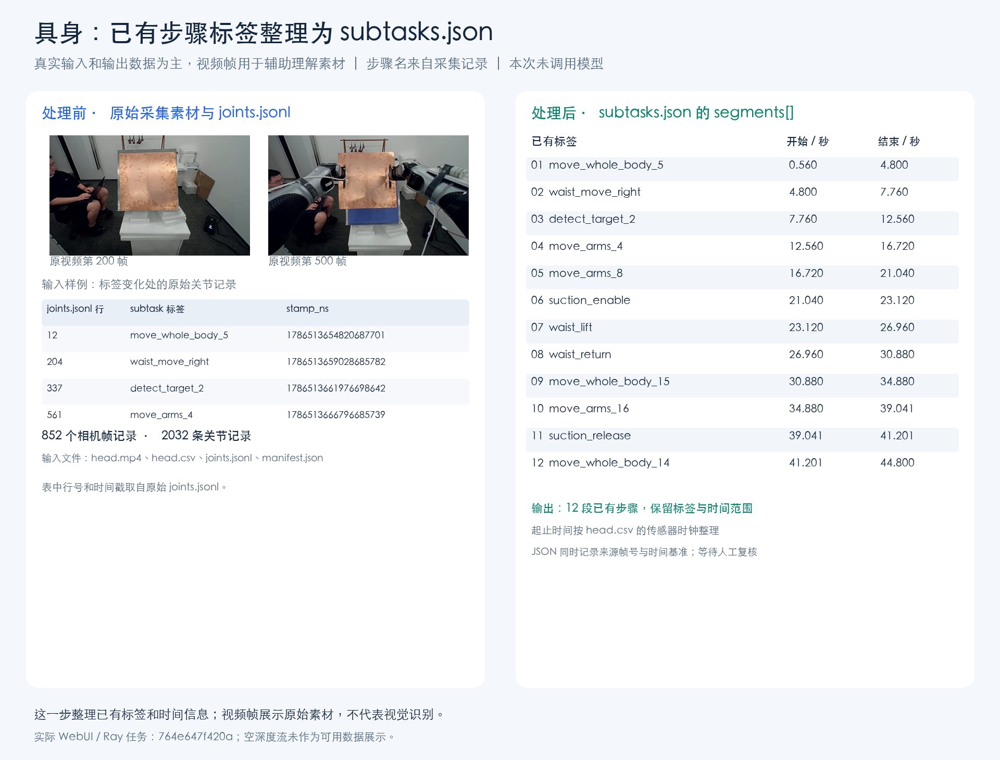
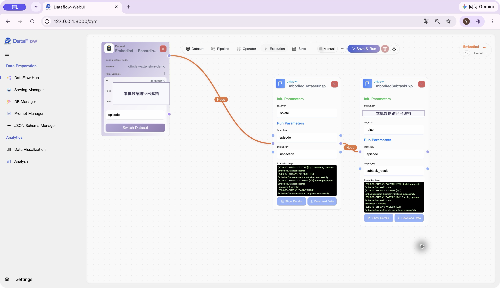

# dataflow-embodied

面向机器人采集数据整理的 [DataFlow](https://github.com/OpenDCAI/DataFlow) 扩展。将采集记录中已有的步骤标签和时间区间转换为 `subtasks.json`，也支持对已适配的机器人数据进行清理，并导出 LeRobot v2.1 数据集。

## 适用场景

- **采集数据已有步骤标签，需要统一文件格式**：把关节记录或采集清单中的步骤及时间整理为独立的 `subtasks.json`，便于检查和后续处理。
- **一段采集中包含静止区间，需要整理有效片段**：根据关节运动和时间信息生成清理计划，保留时间对应关系与质量报告。
- **需要把已支持的采集格式转换为训练数据格式**：导出视频、状态和动作数据，合并为 LeRobot v2.1 数据集并检查文件一致性。

| 功能 | 输入 | 输出 |
|---|---|---|
| 步骤标签转换 | 采集目录中的已有步骤标签、帧索引或时间戳 | `subtasks.json`，包含步骤标签、起止时间和来源 |
| 数据检查与清理规划 | 采集目录中的视频、关节或状态数据及时间记录 | 数据检查报告、保留与删除区间、时间映射 |
| LeRobot 导出与校验 | 支持的采集数据、清理计划和明确确认的任务信息 | LeRobot v2.1 数据集，包含视频、Parquet 和元信息 |

**所有处理均由 Python 代码完成，不调用模型。** 步骤转换使用来源数据中已有的标签；视频参与采集检查、片段清理和数据集导出，不用于识别或生成新的动作描述。

## 安装

需要 Python 3.10–3.12，依赖 `open-dataflow==1.0.11`、`pyarrow==20.0.0`；视频处理使用 `imageio-ffmpeg`。

```bash
git clone https://github.com/Pyromind-Dynamics/dataflow-embodied.git
cd dataflow-embodied
python -m venv .venv
source .venv/bin/activate
python -m pip install --upgrade pip
python -m pip install .
```

## 快速开始：已有步骤标签转为 subtasks.json

准备一个受支持的采集目录，其中包含 `joints.jsonl` 的步骤标签或 `manifest.json` 的步骤记录，以及对应的可靠时间信息。将下例中的 `path` 替换为自己的采集目录：

```python
import json
from pathlib import Path
from dataflow_embodied import EmbodiedSubtaskExporter

exporter = EmbodiedSubtaskExporter(output_dir="artifacts/subtasks")
result = exporter.transform({
    "path": "/data/episode_001",
    "task_text": "搬运铜板",  # 可选；不填时使用来源任务文本
})

output = Path(result["subtasks_path"])
payload = json.loads(output.read_text(encoding="utf-8"))
print("输出文件：", output)
print("步骤数量：", result["segment_count"])
for segment in payload["segments"]:
    print(segment["label"], segment["start_s"], segment["end_s"])
```

处理流程：

```text
已有步骤标签和时间记录 → 读取对应时间区间 → 整理步骤及来源 → subtasks.json
```

文件保存到 `artifacts/subtasks/<来源标识>/subtasks.json`：

| 字段 | 内容 |
|---|---|
| `task_summary` | 任务文本 |
| `segments` | 步骤列表，每段包含原始标签、`start_s`、`end_s` 和来源帧或时间戳 |
| `provenance` | 来源标识、转换方式和复核状态 |

转换保留原始标签，导出结果保持待复核状态。缺少已有标签或可靠时间基准时会报错。输出目录应位于采集目录之外，重复导出同一来源时需换一个输出目录。

## 实际案例：铜板采集记录转为步骤文件

下面使用一段铜板操作的采集数据，演示如何导出 **12 段步骤记录**：

- **处理前**：头部 RGB/深度采集文件、关节数据和已有步骤标签。
- **处理过程**：读取已有标签，根据采集时间记录换算每段的起止时间。
- **处理后**：独立的 `subtasks.json`，保存 12 段标签、时间区间和来源信息。

对比图同时展示采集画面、输入记录和输出 JSON。画面帮助理解数据来自哪段操作，步骤名称来自已有标签。这一案例展示步骤文件转换，清理与 LeRobot 导出用法见下一节。



### 在 DataFlow-WebUI 中运行该案例

同一流程也可以在官方 [DataFlow-WebUI](https://github.com/OpenDCAI/DataFlow-WebUI) 中执行。下图是采集检查与步骤导出的运行示例：



接入方式：

1. 在 WebUI 后端及其 Ray worker 使用的 Python 环境中安装本扩展。
2. 在后端 `backend/app/core/config.py` 的 `_DATAFLOW_EXTENSIONS` 列表中加入 `"dataflow_embodied"`，保留已有条目并重启后端。
3. 选择采集记录，使用 `EmbodiedDatasetInspector` 检查来源、`EmbodiedSubtaskExporter` 导出步骤，配置输入字段及 `output_dir` 后点击 **Save & Run**。

采集文件须能被执行后端访问。`subtasks.json` 保存在后端配置的 `output_dir` 下；DataFlow Storage 中的结果记录包含文件路径和步骤数量。再次运行请选择新的导出目录。

## 其他用法：清理并导出 LeRobot 数据集

这条流程面向视频、关节和状态数据齐全的受支持来源：

```text
采集数据 → 清理计划 → 单段采集导出 → 合并数据集 → 一致性校验
```

无需准备自己的采集文件，也可以用包内生成的小型示例体验整个流程：

```bash
python -m dataflow_embodied.pipelines.demo --output artifacts/cleaning-demo
```

该命令生成示例采集数据，完成清理规划、导出与校验。结果保存在指定的新输出目录：

| 文件或目录 | 内容 |
|---|---|
| `input.jsonl` | 本次处理的采集记录清单 |
| `run/steps/embodied_step1.jsonl` | 清理计划和质量报告 |
| `run/steps/embodied_step2.jsonl` | 各采集记录的导出状态及位置 |
| `run/parts/` | 单条采集记录的导出文件 |
| `dataset/` | 合并后的 LeRobot v2.1 数据集，包含视频、Parquet 和元信息 |
| `summary.json` | 采集记录数、帧数和校验结果 |

处理自己的数据时，`EmbodiedCleaningPipeline` 读取 JSONL，每行包含一个 `episode` 描述。任务文本和相关确认信息需由使用者核实。所有批次导出完成后，再调用一次 `finalize_dataset` 合并；完整调用约定见 [输入格式与接口说明](docs/CONTRACT.md)。

当前适配 S2 本地采集格式及符合本包 S2 特征约定的单任务 LeRobot v2.1 数据。只有步骤标签、缺少视频或状态数据的来源可以做步骤转换，但不能据此生成完整训练数据集。其他机器人格式需要相应适配。

## 算子与 DataFlow 接口

安装后执行 `import dataflow_embodied` 即可注册算子。

| 算子 | 作用 |
|---|---|
| `EmbodiedDatasetInspector` | 检查采集来源、数据流和文件情况 |
| `EmbodiedSubtaskExporter` | 将已有步骤标签转换为 `subtasks.json` |
| `EmbodiedCleaningPlanner` | 生成清理区间、时间映射和质量报告 |
| `EmbodiedLeRobotExporter` | 按清理计划导出单条采集记录 |
| `EmbodiedDatasetValidator` | 校验最终数据集的视频、数据行及元信息 |

算子可直接调用 `transform(...)`，也可通过 `run(storage, input_key=..., output_key=...)` 接入 DataFlow。后者保留输入行和源列，并新增结果列；`output_key` 必须是尚不存在的列。使用 `get_desc("zh")` 或 `get_desc("en")` 可查看各算子的参数和字段说明。

## 开发与文档

```bash
python -m pip install -e '.[dev]'
python -m pytest -q
```

- [来源格式、算子参数与处理约束](docs/CONTRACT.md)
- [验证记录](docs/VALIDATION.md)
- [更新记录](CHANGELOG.md)

代码采用 [MIT 许可证](LICENSE)。第三方代码来源与适配说明见 [THIRD_PARTY_NOTICES.md](THIRD_PARTY_NOTICES.md)。
